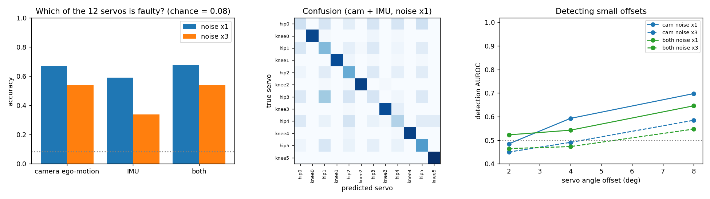

# Camera-based error detection and correction for low-cost legged robots

> Snapshot of the Claude Docs document of the same name, as of 2026-10-23 (doc revision 45).
> The live, editable version is https://claude.ai/artifact/Ax16AW58LEepcwmj5xCWkj (private).
> Written 2026-10-22 for a meeting with the professor on 2026-10-23.

Gross servo faults on a no-feedback hexapod, especially knee faults, leave a readable trace in body motion. The idea is open enough to publish, but a full CVPR 2027 submission by 16 Nov is high-risk.

## Summary

The idea is worth pursuing if it is scoped to gross servo faults plus online correction; the CVPR 2027 deadline is the risky part, not the science.

- **Problem.** MG90S/SC90-class servos report nothing back. A command can be lost, ignored, blocked or mis-set, and the robot cannot tell which. The camera on top cannot see the legs, so any diagnosis has to come from how the body moves.
- **Our own first finding.** The slider that "does not move until I wiggle it" is probably our software, not the servo. In `app.js` each slider change sends one `fetch` with no error check, no acknowledgement and no retry, so one failed request leaves the slider and 3D twin showing an angle the robot never received. To be confirmed with logging and the PCA9685 register readback.
- **Closest prior work.** Hu, Chen and Lipson (arXiv 2022, npj Robotics 2025) use a front camera on a 12-DoF legged robot and flag a broken leg when predicted camera motion disagrees with measured motion. They test one anomaly in both the arXiv and the journal version (a cut end-link), report no detection numbers, do not say which joint failed, and recover by relearning for about 30 minutes.
- **The gap.** I found no paper that diagnoses *which* servo failed and *how*, from a camera that cannot see the legs, on a no-feedback hobby-servo hexapod, and then corrects it online, with numbers.
- **Pilot (simulation, idealised).** Knee faults are localised with 89-100% accuracy, hip faults with only 17-58% (camera plus IMU). An 8 degree offset is detected (AUROC 0.70); 2-4 degree offsets are invisible. Camera-style ego-motion beat IMU-style signals for detection (0.77 vs 0.71) and fault type (0.75 vs 0.58).
- **Decision needed.** CVPR 2027 requires paper enrollment by 10 Nov and the full paper by 16 Nov (25 days from 22 Oct). Alternatives and a go/no-go plan are in the Feasibility section.

## The problem: six ways a no-feedback servo goes wrong

Only some of these errors need a camera; the first one needs no camera at all, and it is the one we have already seen.

| Error | Where it happens | What the robot does | What can see it | Correction |
| --- | --- | --- | --- | --- |
| Command lost | Browser to Bridge to board to PCA9685 (software) | Servo keeps its old angle; slider and twin show the new one | PCA9685 register readback (`/raw`) and command acknowledgements; no camera | Acknowledge, verify by readback, retry |
| Step inside the dead band | Servo electronics | No motion for small steps; hobby sources put the dead band near 5 us of pulse, roughly 0.5 degree (not measured on our servos) | 240 fps camera on the horn on the bench; not body motion (pilot: 2-4 degree errors invisible) | Avoid tiny steps; dither or overshoot |
| Stall or blocked leg | Leg hits a neighbour, the floor or an obstacle; overload | Leg stops short, may buzz | Body ego-motion during the stance phase; IMU | Back off, re-plan the gait |
| Horn slip, spline step, backlash | Mechanics | Constant angle offset on one joint (our horns step in about 8 degree increments) | Body drift and heading error (pilot: 8 degrees visible, 4 degrees or less not) | Estimate a per-joint trim from drift |
| Power sag or brown-out | 2S pack runs 6.4-8.4 V, above the MG90S's 4.8-6 V rating; the board has rebooted while the robot was handled | Servos slow down or the board resets | Pack voltage log; not a vision problem | Log voltage; regulate |
| Dead servo or broken part | Burnt motor, cracked hinge (we had one) | Leg limp or missing | Gross change in ego-motion | Fault-tolerant gait |

**What the code shows.** Each slider move calls `fetch('/set?...', {method: 'POST'})` once, after an 80 ms debounce. Nothing checks the reply or retries. If one call fails or times out, the page and the 3D twin keep the new value while the servo does not. Moving the slider again sends a fresh call, which matches the "wiggle it and it goes" behaviour. A one-hour logging test separates this from real servo faults: send 200 small moves and compare the command, the HTTP reply, and the PCA9685 register for each.

## Related work

I looked up every paper below and read the closest one in full text; the Sources section says how far I got with each. Seven themes, closest work first.

### 1. Closest: camera self-models that notice damage

| Paper | Venue, year | What it does | Gap for us |
| --- | --- | --- | --- |
| [Hu, Chen, Lipson. Egocentric visual self-modeling for autonomous robot dynamics prediction and adaptation](https://arxiv.org/abs/2207.03386) | arXiv 2022 (v3 2024); npj Robotics 2025, DOI 10.1038/s44182-025-00031-6 | 12-DoF legged robot, front camera aimed at the ground. A self-model takes 5 grayscale frames plus the 12 motor commands and predicts the 6-D camera pose change. A large mismatch with visual odometry flags an anomaly; 30 minutes of motor babbling (7,000 steps) retrains the model. | Closest work. The only anomaly is one cut end-link. No detection numbers, no per-joint localisation, about 5 Hz, offline relearning. I read both the arXiv and the journal version in full; the journal version adds no other fault types or detection numbers. Code is public (github.com/H-Y-H-Y-H/Egocentric_VSM). |
| [Chen, Kwiatkowski, Vondrick, Lipson. Full-body visual self-modeling of robot morphologies](https://arxiv.org/abs/2111.06389) | arXiv 2021 | A self-model that answers space-occupancy queries given the robot state; accurate to about 1% of the workspace. The abstract says it can detect, localize and recover from damage. | Same group, earlier. I could not confirm the camera setup from the page. |
| [Li et al. Controlling diverse robots by inferring Jacobian fields with deep networks](https://arxiv.org/abs/2407.08722) | arXiv 2024 (rev. 2025); Nature 2025, DOI 10.1038/s41586-025-09170-0 | One generic camera; a network maps video of the robot to how each 3D point responds to each actuator, giving closed-loop control of very different robots. | Shows command-to-motion maps can be learned from vision alone, but the robot is in view. |

### 2. Fault detection and fault tolerance on legged robots

Pattern: these assume joint encoders, or recover blind without diagnosing. None diagnoses a no-feedback servo from outside the robot.

| Paper | Venue, year | What it does | Gap for us |
| --- | --- | --- | --- |
| [Cully, Clune, Tarapore, Mouret. Robots that can adapt like animals](https://arxiv.org/abs/1407.3501) | Nature 2015 | Hexapod and arm recover from damage in under 2 minutes by trial and error guided by a behaviour map, "without requiring self-diagnosis". | Recovers without diagnosing. I could not confirm how trial performance is measured. |
| [Liu, Zhang, Yin, See. Saving the limping](https://arxiv.org/abs/2210.00474) | arXiv 2022 (submitted to RA-L) | Teacher-student RL for joint-locking failures; zero-shot to a real quadruped. | No separate detector described. |
| [Wu et al. Adaptive control strategy for quadruped robots in actuator degradation scenarios](https://arxiv.org/abs/2312.17606) | arXiv 2023 (DAI '23) | RL policy on a Unitree A1 that copes with sudden joint actuator faults. | Internal sensors only; no diagnosis output. |
| [Lee et al. DreamFLEX](https://arxiv.org/abs/2502.05817) | ICRA 2025 | A network estimates the joint fault vector (overheating, locking) and modulates the gait. | Quadruped; the abstract page does not say which sensors feed it. |
| [Stewart-Height, Jahagirdar, Matni. Learning-based fault detection for legged robots in remote dynamic environments](https://arxiv.org/abs/2604.03397) | arXiv Apr 2026 | Offline learned detector finds the faulty limb from proprioceptive data, then a tripedal gait is chosen. | Needs joint sensing, which our servos lack. |
| [Turrisi, Pali, Oneto, Semini. Mixture-of-experts RL for fault-tolerant legged locomotion](https://arxiv.org/abs/2606.25965) | arXiv Jun 2026 | Fault-diagnosis output selects an expert policy per failure mode; code released. | Robot and sensing not stated on the page. |
| [Gravina et al. Learning fault-tolerant locomotion with adaptive gait timing](https://arxiv.org/abs/2608.07328) | IROS 2026 | 68 kg quadruped, actuator power loss and degradation, learnable gait frequency. | Proprioceptive actor; no detector. |
| [You, Fan, Liu. Fault-tolerant motion planning for a hexapod robot with single-leg failure using a foot force control method](https://journals.sagepub.com/doi/10.1177/17298806221121070) | Int. J. Advanced Robotic Systems 2022 | Hexapod keeps walking after one leg fails. | Failure assumed known. |
| [Fault-tolerant gait for hexapod robots with partial active joints locked](https://www.sciencedirect.com/science/article/abs/pii/S0094114X24003227) | Mechanism and Machine Theory 2025 | Tripod-based gait that works with locked joints. | Failure assumed known; authors not verified. |

### 3. Cameras that read the joint state of cheap, sensorless robots

In every one of these the camera sees the robot. Ours sees none of the legs.

| Paper | Venue, year | What it does | Gap for us |
| --- | --- | --- | --- |
| [Zuo et al. CRAVES: controlling robotic arm with a vision-based economic system](https://arxiv.org/abs/1812.00725) | CVPR 2019 | Low-cost arms with no sensors. A 3D pose estimator trained on synthetic images and adapted to real ones without labels; an RL agent trained in simulation controls the real arm from it. | Arm in view of the camera; no fault logic. |
| [Labbé, Carpentier, Aubry, Sivic. Single-view robot pose and joint angle estimation via render & compare](https://arxiv.org/abs/2104.09359) | CVPR 2021 (oral) | Camera-to-robot pose and joint angles from one RGB image; four robots; trained on synthetic data. | Known robot in view; no fault logic. |
| [Smith, Van Hoorick, Guizilini, Wang. Fiducial exoskeletons: image-centric robot state estimation](https://arxiv.org/abs/2601.08034) | arXiv Jan 2026 | 3D-printed marker mounts on each link give per-link pose from one image; joint angles by optimisation; shown on a low-cost arm. | Markers must be visible. |
| [Jiang, Heyrman, Zurbrügg, Hutter, Holz. Vision as proprioception: estimating humanoid robot pose from video](https://arxiv.org/abs/2610.25288) | arXiv 18 Oct 2026 | Joint configuration of humanoids from video alone; 18-32% lower joint-angle error than the best baseline on three real platforms. | Camera setup not stated on the page; not about faults. |
| [Tira-Thompson. Digital servo calibration and modeling](https://publications.ri.cmu.edu/storage/publications/pub_files/2009/3/CMU-RI-TR-09-41.pdf) | CMU-RI-TR-09-41, 2009 | Camera-measured servo bias within about 0.21 degree and deviation 0.36 degree on seven digital servos with feedback (numbers from a search snippet; I could not open the PDF). | Nearest servo-accuracy study found, but not hobby PWM servos. |
| [Visual servoing for low-cost SCARA robots using an RGB-D camera as the only sensor](https://www.tandfonline.com/doi/full/10.1080/00051144.2018.1461771) | Automatika 2018 | Marker tracking gives joint-angle changes for arms without encoders. | Authors not verified; the page was blocked. |

### 4. Reading an unseen body from the camera's own motion

This works for people at CVPR, ECCV and NeurIPS. For robot faults it is open.

| Paper | Venue, year | What it does | Gap for us |
| --- | --- | --- | --- |
| [Yuan, Kitani. 3D ego-pose estimation via imitation learning](https://openaccess.thecvf.com/content_ECCV_2018/papers/Ye_Yuan_3D_Ego-Pose_Estimation_ECCV_2018_paper.pdf) | ECCV 2018 | Body pose sequence of the camera wearer from one head-mounted camera, physically plausible, without observing the body. | Humans, not robots. |
| [Luo, Hachiuma, Yuan, Kitani. Dynamics-regulated kinematic policy for egocentric pose estimation](https://arxiv.org/abs/2106.05969) | NeurIPS 2021 | A MuJoCo physics simulation with a humanoid controller keeps the estimated poses physical. | Humans, not robots. |
| [Li, Liu, Wu. Ego-body pose estimation via ego-head pose estimation](https://arxiv.org/abs/2212.04636) | CVPR 2023 (award candidate) | Front-facing head camera. Head motion comes from SLAM plus learning; a diffusion model then generates full-body motion. The body is "often unobserved". | Humans; shows CVPR interest in this structure. |
| [Agarwal, Kumar, Malik, Pathak. Legged locomotion in challenging terrains using egocentric vision](https://arxiv.org/abs/2211.07638) | CoRL 2022 (oral) | Single front depth camera on a quadruped; learned policy for stairs, curbs and gaps. | Ego-vision used for terrain; the page mentions no faults. |
| [Fu et al. Coupling vision and proprioception for navigation of legged robots](https://openaccess.thecvf.com/content/CVPR2022W/MULA/papers/Fu_Coupling_Vision_and_Proprioception_for_Navigation_of_Legged_Robots_CVPRW_2022_paper.pdf) | CVPR 2022 workshop (MULA) | Combines vision and proprioception for legged navigation. | Navigation, not fault diagnosis. |

### 5. Ego-motion on a walking robot: the tools and the difficulty

Good ego-motion tools exist. Blur and shake from walking are the known problem, and global-shutter cameras help.

| Paper | Venue, year | What it does | Use for us |
| --- | --- | --- | --- |
| [Teed, Deng. RAFT](https://arxiv.org/abs/2003.12039) | arXiv 2020 | Optical-flow network; at release 16% lower error on KITTI and 30% on Sintel (final pass). | Standard flow backbone; offline on the laptop, too heavy for the Uno Q. |
| [Teed, Deng. DROID-SLAM](https://arxiv.org/abs/2108.10869) | arXiv 2021 | Learned SLAM that refines camera pose and per-pixel depth with dense bundle adjustment; monocular, stereo or RGB-D. | Strong monocular baseline. |
| [Teed, Lipson, Deng. Deep patch visual odometry](https://arxiv.org/abs/2208.04726) | arXiv 2022 | Beats DROID-SLAM using a third of the memory and running about 3 times faster. | Likely the practical VO baseline. |
| [Wang, Hu, Scherer. TartanVO](https://arxiv.org/abs/2011.00359) | CoRL 2020 | Learned VO trained only on synthetic data generalises to real datasets; camera intrinsics are an input. | Up to scale; shows synthetic-to-real VO is possible. |
| [Zhou, Dai, Li. Ground-plane based absolute scale estimation for monocular visual odometry](https://arxiv.org/abs/1903.00912) | IEEE T-ITS | Metric scale from the ground plane and the known camera height. | Our camera height is fixed, so metric speed is available. |
| [Yang, Zhang, Fu, Manchester. Cerberus](https://arxiv.org/abs/2209.07654) | arXiv 2022 (submitted to ICRA 2023) | Fuses stereo, IMU, joint encoders and contact sensors; robust to impacts and occlusion. | Needs encoders we do not have. |
| [Pretto et al. A visual odometry framework robust to motion blur](http://ais.informatik.uni-freiburg.de/publications/papers/pretto09icra.pdf) | ICRA 2009 | Strong blur from a walking humanoid breaks feature trackers; estimates blur per image patch. | Old, but shows the problem is long known. |
| [Zhu, Tang, Yang, Learned-Miller, Kim. Event camera-based visual odometry for a legged robot](https://arxiv.org/abs/2305.08962) | arXiv 2023 | Event plus RGB-D odometry on a Mini-Cheetah during jumps. | Event cameras sidestep blur; too costly for us. |
| [Corlito et al. Sensor configuration matters](https://arxiv.org/abs/2606.19067) | arXiv Jun 2026 | On an ANYmal D, global-shutter cameras cut tracking failures versus rolling shutter; plain inertial integration can hurt vision SLAM under harsh legged motion. | Choose a global-shutter camera. |

### 6. Failure detection from video, for tasks rather than actuators

| Paper | Venue, year | What it does | Gap for us |
| --- | --- | --- | --- |
| [Thoduka, Gall, Plöger. Using visual anomaly detection for task execution monitoring](https://arxiv.org/abs/2107.14206) | IROS 2021 | A network trained on successful runs predicts optical flow; the robot's kinematics and 3D model predict camera and body motion; the gap is the anomaly score. Modelling camera and body motion raised AUROC from 0.752 to 0.804. | Same residual idea as ours, but for task failures, with known kinematics. |
| [AHA: a vision-language model for detecting and reasoning over failures in robotic manipulation](https://arxiv.org/abs/2410.00371) | ICLR 2025 | Open VLM (NVIDIA, University of Washington and collaborators) trained on procedurally perturbed demonstrations; reports beating GPT-4o in-context by 10.3%. | Manipulation; failure types fixed by the training data. |
| [I-FailSense: towards general robotic failure detection with vision-language models](https://arxiv.org/abs/2509.16072) | arXiv 2025 | Trainable classification head on a VLM; argues a generative model is not tuned for discriminative accuracy. | Manipulation. |
| [Santhanam, Mitrevski, Thoduka, Houben, Hassan. Reliable robotic task execution in the face of anomalies](https://arxiv.org/abs/2510.23121) | RA-L (accepted), arXiv Oct 2025 | Anomaly detector trained on nominal runs plus three recovery levels (pause, perturb, reset to safe state) on a Kinova and an xArm. | Arms; external visual anomalies. |
| [Dura, Balmus, Ionescu. RoboVAD](https://arxiv.org/abs/2609.17843) | arXiv Sep 2026 | Benchmark for video anomaly detection in arm manipulation; all methods stay under 70% micro frame-level AUC in the hardest setup. | Shows demand; no legged data. |

### 7. Low-cost legged hardware and servo-level problems

I found no peer-reviewed study of PWM hobby-servo dead band, dropout or repeatability; the sources are forums and vendor pages. That is itself a gap a bench characterisation could fill.

| Paper | Venue, year | What it does | Gap for us |
| --- | --- | --- | --- |
| [Qu, Li, Zakhor, Yu, Zhang. Versatile locomotion skills for hexapod robots](https://arxiv.org/abs/2412.10628) | arXiv Dec 2024 | $600 SpiderPi hexapod, 18 servos with "no real time joint feedback", depth camera plus visual-inertial odometry; teacher-student RL for stairs, obstacles and squeezing. | Same class of hardware; no fault handling; its page lists no major venue. |
| [Weddington, Ölveczky, Baccus. Reinforcement learning on cost-constrained quadrupedal hardware](https://arxiv.org/abs/2607.26434) | arXiv Jul 2026 | Mini Pupper 2 with over 50 ms delay and noisy feedback; a delay-aware network learns a rhythmic gait robust to +320 ms. | Delay and noise, not faults. |
| [Yamamori et al. Actuator reality shaping for zero-shot sim-to-real robot learning](https://arxiv.org/abs/2607.02205) | arXiv 2026 | A feedforward-feedback controller per joint makes real actuators behave like the ideal simulated ones. | Needs actuators we can measure and command. |
| [Shi et al. ToddlerBot](https://proceedings.mlr.press/v305/shi25a.html) | CoRL 2025 | Open-source 3D-printed humanoid (under $6,000) with calibration and motor system identification for zero-shot sim-to-real. | Servos with feedback. |
| [SPINDER: open-source 18-DoF hexapod](https://www.nature.com/articles/s41598-026-56856-0) | Scientific Reports 2026 | Dynamixel servos, depth camera, IMU, foot switches. A search snippet reports a dead band near 0.5 degree and stall detection from status packets. | Page was paywalled; snippet only. Even good servos need dead-band handling. |

## Gap analysis

No group of papers covers all six capabilities; the nearest, Hu et al., misses three outright (which joint, online correction, numbers) and does not say whether the legs are visible. This is from abstracts and pages, so "not stated" means I could not tell, not that it is absent.

| Work | Works without joint sensing | Camera cannot see the robot | Says which joint failed | Corrects online | Legged | Numbers reported |
| --- | --- | --- | --- | --- | --- | --- |
| Hu, Chen, Lipson (self-model; both versions read) | yes (their observations are commands and video only) | not stated | no | no (about 30 min relearn) | yes | no (qualitative) |
| Proprioceptive fault detectors (Stewart-Height 2026, DreamFLEX, mixture-of-experts RL) | no | not applicable | yes (limb or joint fault vector) | yes (gait or policy switch) | yes | not stated on abstract pages |
| Blind fault tolerance (Cully 2015, Saving the Limping, ADAPT, gait timing) | partly | not applicable | no, by design | yes | yes | Cully yes; others not stated |
| Camera joint-state estimators (CRAVES, Labbé 2021, Fiducial Exoskeletons, Vision as Proprioception) | yes | no, the robot is in view | yes (joint angles) | partly (CRAVES controls an arm) | no (arms, humanoid video) | partly |
| Video failure detectors (Thoduka 2021, AHA, I-FailSense, RA-L 2025) | no (use kinematics or joint states) | partly | no | partly (RA-L 2025 recovers) | no | yes |
| **This proposal** | yes | yes | yes | yes | yes (hexapod) | yes (target) |

## How we differ from Hu et al. and the other closest work

Hu et al. share our ingredients, so we cannot claim "a camera notices damage". What is left to claim is below, and each item is a goal to demonstrate, not a result so far.

### What Hu et al. do (arXiv and journal versions, both read in full)

1. **Babble.** A hill-climbed sinusoidal gait plus Gaussian noise (purely random commands trained poorly): 100,000 steps per floor texture in simulation (PyBullet) with domain randomisation, transferred to the real robot without extra training. About 30 minutes (7,000 steps) of real babbling is used only for recovery.
2. **Self-model.** Five grayscale 128 x 128 frames plus 24 commanded joint angles (previous and next step) go in; the 6-D camera pose change (x, y, z, roll, pitch, yaw) comes out. A 48-layer convolutional encoder, five LSTM modules, mean-squared-error loss.
3. **Visual odometry model.** Seven frames in, the same 6-D pose change out, no commands.
4. **Control.** Sample 100 candidate commands, predict each outcome on a GPU (RTX 3090), run the best one. About 5 Hz.
5. **Anomaly.** A cut end-link on the right hind leg. A large gap between predicted and measured motion "can trigger an alarm"; no threshold is given and the paper does not say whether the check is automatic.
6. **Recovery.** About 30 more minutes of babbling on the damaged robot, with the visual-odometry output as labels, until predictions match again. The result is qualitative: it "recovers forward locomotion".
7. **Not done.** No statement of which joint or leg is at fault, no fault types, no detection numbers, no speed or recovery numbers, no limitations section in the arXiv version (the journal version lists limits).

Hardware in the journal version: a 12-DoF quadruped on Hiwonder LX-224 serial bus servos (0.3 degree accuracy), a Raspberry Pi 4 plus an RTX 3090 desktop, and a camera (87 x 58 degree field of view, 60 fps) tilted 41 degrees down at the floor. Real-robot evaluation used 3 trials per method; the simulation tables use 10 episodes.

### What we would add

| Hu et al. | This proposal | Evidence so far |
| --- | --- | --- |
| Notices that the dynamics changed | Names which of 12 servos failed and how (stuck, dropped command, offset) | Simulation pilot: servo 67%, type 75%; knees far better than hips |
| Qualitative alarm | Detection AUROC, false alarms per minute, time to detect, servo and type accuracy | None on real data yet |
| Persistent damage, fixed by about 30 minutes of retraining | Intermittent command-execution faults, corrected in seconds (verify and retry, trim, gait switch) | None yet; verify-and-retry needs no camera |
| One 12-DoF quadruped on Hiwonder LX-224 bus servos (0.3 degree accuracy), a Raspberry Pi 4 plus an RTX 3090 desktop, camera tilted 41 degrees down at 60 fps; 5 Hz | 12-servo hobby hexapod; target 20 Hz on cheap compute | The 20 Hz command loop is measured (about 30 ms per call); inference is not built |
| IMU used only as a prediction baseline | Camera, IMU and both compared for diagnosis | Simulation pilot: camera-style beat IMU-style at low noise |
| No benchmark | Exact-label fault benchmark, simulation and real | Firmware fault injection designed, not built |

Their method also becomes our Tier 1 baseline: we re-implement it and compare against it.

### Against the other groups

| Group | Where we differ | Where they win |
| --- | --- | --- |
| Proprioceptive fault detectors (Stewart-Height 2026, DreamFLEX, mixture-of-experts RL) | We have no joint sensing and observe from outside the legs | With encoders they should be more accurate; treat them as a ceiling |
| Blind fault tolerance (Cully 2015, Saving the Limping, ADAPT) | We diagnose, which allows targeted fixes such as retry or trim | For some faults, blind adaptation may recover as well; we must compare |
| Camera joint-state estimators (CRAVES, Labbé, Fiducial Exoskeletons) | No external camera or markers; the robot monitors itself anywhere | Far more precise when the robot is in view; we do not compete on accuracy |
| Video failure detectors (Thoduka 2021, AHA) | Actuator faults on a legged robot, per servo | The mechanism (observed versus predicted motion) is not new; Thoduka et al. used it for tasks |
| Ego-pose from a head camera (Yuan and Kitani, EgoEgo) | Robots and faults, not human pose | Supports feasibility, not novelty |

**The risk.** If the experiments show only that a camera notices something is wrong, the paper is incremental over Hu et al. The contribution holds only if the diagnosis (which servo, what kind) and the correction loop show measurable gains. I have now read the 2025 journal version: it adds no other fault types and no detection numbers. Its own stated limits are dependence on static ground, a short prediction horizon and extreme visual conditions.

### Likely objections and answers

| Objection | Answer | What backs it |
| --- | --- | --- |
| "This is Hu et al." | They show a camera plus commands can notice a changed body: one cut end-link, qualitative, fixed by about 30 minutes of retraining. We name which servo failed and how, correct it online, and report numbers. Their method is our baseline. | Needs the real-robot results |
| "Buy servos with feedback." | Their own robot uses bus servos with 0.3 degree accuracy, yet their model sees only commands and video. More to the point, a servo reads its own shaft, so a slipped horn or a cracked link can look healthy to it, while body motion shows it. Hobby kits without feedback are also widely used. | Slipped-horn case untested; the cost argument needs numbers |
| "The IMU already carries this signal." | Partly true, and the pilot says so. The camera adds motion relative to the world: did the body move, slip, drift in heading. We test camera, IMU and both, and report it even if the camera adds nothing. | Pilot is simulation only |
| "Hips are not detectable." | Correct in the pilot (17-58%). We claim knee and gross faults, and test active probing for hips. | Active probing untested |
| "Only simulation evidence." | The pilot only shows the information is in the signal. The real-robot dataset is the plan. | No real data yet |

## Research questions and contributions

Four questions, each testable on the hexapod and in simulation.

1. **Observability.** Which servo faults leave a signature in the ego-motion of a body-mounted camera that sees no legs, and how large must the error be? Pilot answer so far: gross faults yes, 4 degrees or less no.
2. **Diagnosis.** From video plus the commanded joint trajectories, can a model say which of the 12 servos failed and how (stuck, dropped command, offset), and does it beat an IMU-only diagnoser?
3. **Correction.** Does acting on the diagnosis (re-send and verify, per-joint trim, gait re-plan) restore walking speed and heading on open-loop servos, compared with no correction?
4. **Active probing (extension).** Hip faults are hard to see during normal walking. Can a short diagnostic motion make them observable?

**Contributions we could claim:**

- A quantitative study of servo-fault diagnosis from egocentric ego-motion on a no-feedback hexapod, with an IMU baseline.
- A benchmark: egocentric video with injected faults and ground truth, in simulation and on the real robot.
- A diagnosis-plus-correction loop evaluated by recovery of speed and heading, not just detection accuracy.
- Open code, twin and data.

The overlap with Hu et al. is real, so the framing must be per-servo diagnosis plus online correction plus numbers, not "a camera notices damage".

## Method: three detectors of rising effort, then a correction step

The pipeline is the same at every tier: commanded joints and camera frames go in, an ego-motion estimate comes out, the gap to the expected motion becomes a diagnosis, and the diagnosis triggers a correction.

| Tier | Idea | Needs | Main risk |
| --- | --- | --- | --- |
| 0. Analytic residual | Compare measured ego-motion (visual odometry or optical flow, metric scale from the known camera height) with a healthy template per gait phase; threshold the gap | Healthy walking data only; no training | Hips and small errors invisible; VO quality |
| 1. Learned forward model | Hu-style self-model: commanded joints plus frames predict ego-motion; residual statistics per gait phase go to a classifier | Healthy data for the model; labelled faults for the classifier | Reproducing Hu et al.; their model is 5 Hz |
| 2. Direct diagnosis network | Optical-flow clips plus the commanded joint trajectory feed heads for fault present, which servo (12-way), type, and size | Labelled faults, mostly synthetic, plus real fine-tuning | Sim-to-real gap; needs the most data |

**Correction step.** Each diagnosis maps to an action:

- Command lost: acknowledge, read back the PCA9685 register, retry. No camera needed, and the cheapest reliability win.
- Step inside the dead band: send an overshoot or a small dither, then settle.
- Offset: estimate a per-joint trim from heading drift and add it to the command.
- Stuck or broken leg: switch gait (for example tripod to a pattern that skips that leg) or stop.

**Two design choices to defend.** Use the commanded joint trajectory as an input, since the controller knows it. Treat the camera as one of several signals and always compare against an IMU-only diagnoser, because the pilot shows the IMU already carries part of the information.

## Simulation pilot: servo faults show up in body motion, knees far more than hips

In simulation, a faulty servo is named correctly 67% of the time (chance 8%) from camera-style ego-motion alone. Knee faults are localised at 89-100%, hip faults at only 17-58% (camera plus IMU), and offsets of 4 degrees or less are invisible.

**Setup.**

- Robot: the lean MuJoCo twin of the hexapod (522 g) walking the open-loop tripod gait at 20 Hz.
- Faults: one servo, at a random moment, either stuck (ignores all later commands) or offset by +8 or -8 degrees. That is 34 fault configurations with 10 episodes each (stuck hip0 and hip3 are excluded: they never move in this gait, so "stuck" is no fault). Plus 120 healthy episodes and 144 episodes of 2, 4 and 8 degree offsets. All 604 episodes walked without falling.
- Signals, synthetic: camera-style is body-frame linear and angular velocity with a per-episode scale error (a monocular property) and noise; IMU-style is specific force, gyro and gravity direction. Noise "x1" is about what our IMU showed while handled; "x3" is triple.
- Tasks: detect (unsupervised, trained on healthy data only), which servo (12-way), which type (stuck, +offset, -offset). One window is one gait cycle (1.2 s) aligned to the commanded gait clock. Train and test are split by episode (510 test windows).

| Signal | Noise | Detect, AUROC (stuck / offset) | Which servo | Which leg | Which type |
| --- | --- | --- | --- | --- | --- |
| Camera ego-motion | x1 | 0.77 (0.88 / 0.72) | 67% | 67% | 75% |
| IMU | x1 | 0.71 (0.78 / 0.67) | 59% | 60% | 58% |
| Both | x1 | 0.72 (0.81 / 0.68) | 68% | 68% | 72% |
| Camera ego-motion | x3 | 0.66 (0.74 / 0.62) | 54% | 56% | 56% |
| IMU | x3 | 0.59 (0.71 / 0.53) | 34% | 38% | 48% |
| Both | x3 | 0.62 (0.68 / 0.59) | 54% | 56% | 53% |

Chance level: 8% for the servo, 17% for the leg, 33% for the type, 0.50 AUROC.

**What it says.**

- Knees are readable, hips are not. Per servo (camera plus IMU, noise x1), knees 0-5 localise at 91, 89, 93, 89, 93 and 100%; hips 0-5 at 20, 44, 51, 17, 31 and 58%. Knees lift the body; hips swing the leg sideways with little effect on body motion in this gait.
- Small errors are out of reach. Detection of a 2 degree offset is at chance (0.48), 4 degrees is 0.59, 8 degrees is 0.70 (camera, noise x1). A dead-band error of about 1 degree is far below that. The camera cannot fix dead-band errors; it can catch gross faults and slow drift.
- Camera-style signals beat IMU-style at low noise (detection 0.77 vs 0.71, type 0.75 vs 0.58), which suggests the translation information helps. Combining both did not help detection, because extra noisy dimensions dilute an unsupervised detector. Not a general claim.
- Noise matters. Tripling it cuts servo localisation from 67% to 54%, and real visual odometry on a shaking robot may be worse than either level.

**Caveats, before quoting any number.**

- Simulation only, one gait, abrupt faults. Train and test come from the same simulator, so no sim-to-real gap is included.
- The camera signal is clean 6-DoF ego-motion plus synthetic noise, not the output of a real visual-odometry system on shaking video.
- This measures the information in the signal, not a finished method. Code: `fault-pilot/pilot_observability.py` (about 20 seconds to run).

## Experiment plan: inject faults we control, measure with tools we already have

Faults are injected in the board firmware so the ground truth is exact; walking is measured by an overhead tag. The only new hardware is the camera.

| Fault | How we inject it | Ground truth |
| --- | --- | --- |
| Command lost | Firmware drops or delays commands to channel k with probability p | Firmware log of every dropped command |
| Stuck servo | Firmware freezes channel k at its current value | Firmware log |
| Angle offset | Firmware adds a fixed +d or -d degrees to channel k | Known d |
| Dead band | Firmware ignores steps smaller than d degrees | Known d |
| Blocked leg (physical) | A stopper in the leg's path | Side-camera video, annotated |
| Loose horn (physical) | Loosen the horn screw | 240 fps horn video on the bench |
| Low battery (physical) | Run on a depleted pack | Pack voltage log |

**Data.**

- Simulation: the MuJoCo twin with a body camera rendered in it, randomised floor texture, friction and mass; thousands of episodes with exact labels.
- Real robot: at least 10 runs per fault condition on two floor surfaces (our own target, not a published standard), with the overhead camera and tag recording body pose.
- Train mostly on simulation, fine-tune and test on real data, and report the sim-to-real gap.

**Baselines.** IMU-only diagnoser; the Tier 0 analytic residual; a re-implemented Hu-style self-model residual; optionally a zero-shot vision-language model on egocentric clips (AHA-style); and walking with no correction.

**Metrics.**

- Detection: AUROC, false alarms per minute of healthy walking, time to detect.
- Diagnosis: 12-way servo accuracy, leg accuracy, fault-type accuracy, error in the estimated offset.
- Correction: forward-speed ratio against healthy walking, heading drift in degrees per second, run success, and the command-loss rate before and after verify-and-retry.

**Ablations.** Camera only, IMU only, both; with and without the commanded joint trajectory; frame rate (10 to 60 fps); shutter and blur; floor texture; fault size; detector tier.

## Feasibility, risks and timeline

The science is feasible over a few months. A CVPR 2027 full paper by 16 Nov (25 days from 22 Oct) is not a safe plan: the camera, the real fault data and the correction loop do not exist yet.

### Where it could go

| Venue | Dates | Fit | Note |
| --- | --- | --- | --- |
| [CVPR 2027 main track](https://cvpr.thecvf.com/Conferences/2027/CallForPapers) | Enrolment 10 Nov, paper 16 Nov, supplement 23 Nov 2026 (all anywhere on Earth); reviews 25 Jan, rebuttal to 1 Feb, decision 25 Feb 2027 | Best vision framing | Authors must agree to review. No substantially similar paper may go to another conference or workshop between 16 Nov and 22 Feb. |
| WACV 2027 | Both rounds closed (26 Jun and 28 Aug 2026) | - | Too late |
| IROS 2027 | 1 Mar 2027 (third-party listing) | Robotics, CORE A | Realistic full-paper target: about four months for real-robot work |
| CVPR 2027 workshops | Not checked | Short paper | Look at the embodied-AI and vision-for-robotics workshop pages |
| ICRA 2028 | About mid-Sep 2027 (estimate) | CORE A* | Backup |
| CoRL 2027 | About late May 2027 (estimate) | Top-tier, unranked by CORE | Stretch |
| RA-L | Rolling | Journal | Fits a longer version |

### Risks

| Risk | Why it matters | Mitigation |
| --- | --- | --- |
| Overlap with Hu et al. | They already show camera plus commands flagging damage on a 12-DoF legged robot | Differentiate on per-servo diagnosis, fault type, online correction, hobby servos and numbers |
| Camera adds little over the IMU | The pilot shows the IMU already carries part of the signal | Always include an IMU-only baseline; stress translation, heading and slip, which the IMU cannot see |
| Ego-motion under walking shake | Blur, rolling shutter and a plain floor break visual odometry | Global-shutter camera, textured mat, 30-60 fps; measure VO error against the overhead tag before anything else |
| Hips and small offsets invisible | Pilot: hips 17-58%, 4 degrees or less at chance | Claim gross faults only; try active probing; be explicit about the limit |
| No camera on the robot yet | Nothing real can be recorded | Pick a camera this week; start with a USB camera on the laptop |
| Real fault labels are hard | There is no joint sensing to label from | Firmware injection for exact labels; bench horn video for checks |
| Time | 25 days to CVPR | Go/no-go gates below |

### If you choose the CVPR sprint

| By | Gate | Stop if |
| --- | --- | --- |
| 29 Oct | Camera mounted; a real ego-motion estimate on walking footage, checked against the overhead tag | Visual-odometry error is too large to see an 8 degree fault |
| 5 Nov | Body camera rendered in simulation; firmware fault injection working; Tier 0 and Tier 1 numbers in simulation; first real stuck and offset runs recorded | Real runs show no signal |
| 10 Nov | Enrol the paper or not | Either gate failed |
| 16 Nov | Submit a simulation-heavy benchmark with thin real data | - |

**My assessment.** The sprint would yield a simulation-heavy benchmark with thin real data, which is a weak CVPR submission. Its lasting value is the arXiv preprint, the dataset and the code, which an IROS 2027 version (1 Mar) can then extend with real-robot recovery results. This is my judgement, not a prediction of acceptance. The servo-identification work (the other paper plan) shares the twin and IMU, so the professor should also decide whether the two papers merge.

## What we already have, and what is missing

Most of the infrastructure exists; the camera and the real fault data do not.

| Item | Status | Note |
| --- | --- | --- |
| MuJoCo twin of the hexapod, CAD-derived, with a physics version | Ready | Collisions are about 5 mm optimistic; body mass and servo strength are estimates |
| Body camera in simulation | To build | MuJoCo can render from a camera on the base; I estimate one to two days |
| Open-loop tripod gait and a learned walking policy | Ready in simulation | Policy: 51 mm/s at a 60 mm/s command, in simulation only |
| IMU on the robot | Wired and flashed on 22 Oct | Polling through the Bridge gives about 100 Hz with gaps; record on the board and download instead |
| Web control, channel mapping, PCA9685 readback (`/raw`) | Ready | Needs acknowledgement and retry, which is the slider problem |
| Overhead pose tracker (AprilTag) and 240 fps horn-angle tracker | Scripts ready | Tested on synthetic video only |
| Camera on the real robot | Missing | Choose a global-shutter camera; start with a USB camera on the laptop |
| Real walking data | None yet | The hinge is repaired; first walks are pending |
| Compute | RTX 4060 laptop, 8 GB, with WSL2 | Enough for simulation data and small models |

## What this does for a CMU or NUS robotics application

A public preprint with code and a demo video helps more than a paper under review, because CVPR decisions (25 Feb 2027) arrive after the CMU deadline.

- **CMU MS in Robotics.** The Fall 2026 cycle ran 3 Sep to 10 Dec 2025. Fall 2027 dates were not posted when I checked; an aggregator lists 10 Dec 2026, which is unconfirmed. I could not open CMU's own page in this session, so confirm the deadline and the GRE rule on the [CMU MSR how-to-apply page](https://www.ri.cmu.edu/education/academic-programs/master-of-science-robotics/how-to-apply/).
- **NUS MSc Robotics.** The August 2026 window ran 4 May to 1 Jun 2026. The August 2027 window is not posted; expect something similar and check the [NUS programme page](https://nusgs.nus.edu.sg/programmes/m-sc-in-robotics-coursework).
- **What you can show by early December.** An arXiv preprint with code, a short video of the robot diagnosing and correcting a fault, and a letter from the professor.
- **Honest limit.** I cannot tell how an admissions committee weighs a submitted but undecided paper. Ask the professor and recent admits.

## Questions to ask the professor

1. Which target: a CVPR 2027 sprint, IROS 2027, or an arXiv preprint plus a workshop paper?
2. Is the overlap with Hu, Chen and Lipson acceptable, and how should we position against it?
3. Can the lab lend a global-shutter camera and a motion-capture or overhead reference for ground truth?
4. Should this merge with the servo-identification paper, or stay separate?
5. Is a second robot, not built by us, available for a generalisation test?
6. Is there GPU access beyond one 8 GB laptop for dataset generation and training?
7. Does the work have to run on the Uno Q, or is offline analysis on a laptop enough?
8. Is a vision-language-model diagnoser (AHA-style) of interest, or do we stay with small learned models?
9. Authorship, and the timing of a recommendation letter for the December and spring application deadlines.

## Sources and how far I verified them

Every paper links to its page in the Related work tables. This section says how much of each I actually read, as of 23 Oct 2026. Details such as venues and "not stated" entries come from abstract pages, so check the paper before quoting.

- **Read in full text:** Hu, Chen, Lipson (arXiv 2207.03386 v3 HTML, and the npj Robotics 2025 PDF); the [CVPR 2027 call for papers](https://cvpr.thecvf.com/Conferences/2027/CallForPapers).
- **Read on the arXiv listing page (title, authors, date, abstract):** Chen et al. 2021; Li et al. (Jacobian fields); Cully et al.; Saving the Limping; Wu et al.; DreamFLEX; Stewart-Height et al.; Turrisi et al.; Gravina et al.; CRAVES; Labbé et al.; Fiducial Exoskeletons; Jiang et al.; EgoEgo; Agarwal et al.; RAFT; DROID-SLAM; DPVO; TartanVO; Zhou et al.; Cerberus; Zhu et al.; Corlito et al.; Thoduka et al.; Santhanam et al.; RoboVAD; Qu et al.; Weddington et al.; Yamamori et al.
- **Seen only in search-result summaries, not opened:** AHA and I-FailSense; Yuan and Kitani 2018; Luo et al. 2021; Fu et al. 2022; Pretto et al. 2009; the CMU servo report numbers; ToddlerBot; You et al. 2022; the 2025 Mechanism and Machine Theory paper; the [Princeton hobby-servo primer](https://www.princeton.edu/~mae412/TEXT/NTRAK2002/292-302.pdf) behind the 5 microsecond dead band; the [WACV 2027 call](https://wacv.thecvf.com/Conferences/2027/CallForPapers); the [IROS 2027 listing](https://mldeadlines.com/conference/iros/) (third party).
- **Could not open:** the SPINDER paper (login redirect); the Automatika SCARA paper (blocked); the CMU report PDF and CMU's application page (certificate error).
- **Seen only as a citation and left out:** Hou et al., ICRA 2024, multi-task active fault-tolerant control for quadruped leg failures.
- **Estimates, not sourced:** CoRL 2027 and ICRA 2028 dates (extrapolated from earlier years).
- **Our own work:** the simulation pilot (`fault-pilot/pilot_observability.py`), the physics model and tracker scripts in the project folder, and the slider code reading in `servo-web-control/assets/app.js`.
